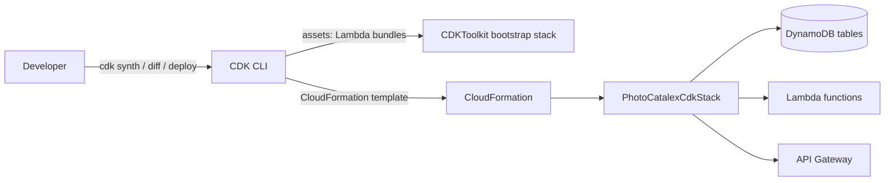
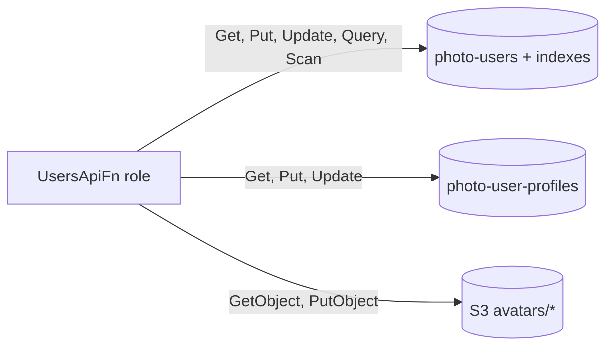

# Architecture

## Current state (deployed)

```mermaid
flowchart LR
    subgraph Existing["Existing resources (referenced, not managed by CDK)"]
        C[(photo-categories)]
        P[(photo-pictures)]
        COG[Cognito User Pool]
    end
    subgraph Stack["PhotoCatalexCdkStack (eu-central-1)"]
        UA["Lambda: UsersApiFn"] -->|read/write| U[(photo-users)]`n        UA -->|read/write| UP[(photo-user-profiles)]`n        UA -->|avatars/*| AV[(S3: photo-ca-user-profiles)]
        U --- UI[["GSI: username-index"]]
    end
```

## Target state

Dashed boxes are planned and not yet in the stack.

```mermaid
flowchart LR
    User((User)) --> CF[CloudFront]
    CF -->|static assets| S3[(S3: Angular app)]
    CF -->|/api/*| APIGW[API Gateway REST API]
    APIGW -->|token check| COG[Cognito User Pool]
    APIGW --> UA[UsersApiFn]`n    UA --> U[(photo-users)]`n    UA --> UP[(photo-user-profiles)]
    classDef planned stroke-dasharray: 5 5;
    class CF,S3 planned;
```

## Authorization flow

```mermaid
sequenceDiagram
    participant App as Angular app
    participant GW as API Gateway
    participant Cog as Cognito User Pool
    participant Fn as Lambda
    participant DB as DynamoDB
    App->>GW: GET /user (Authorization: ID token)
    GW->>Cog: Validate token
    Cog-->>GW: Valid, claims (sub, cognito:groups)
    GW->>Fn: Event with claims
    Fn->>Fn: userId = sub; admin routes require group admins
    Fn->>DB: GetItem(userId)
    DB-->>Fn: Item
    Fn-->>App: 200 with item
```

## Routes

See the API routes table in the README (`/user`, `/user/profile`, `/user/avatar`, `/users`, `/users/{userId}`).

## Deployment flow



## Permissions



The Lambda has no delete permissions and can only touch the vatars/ prefix in S3.
